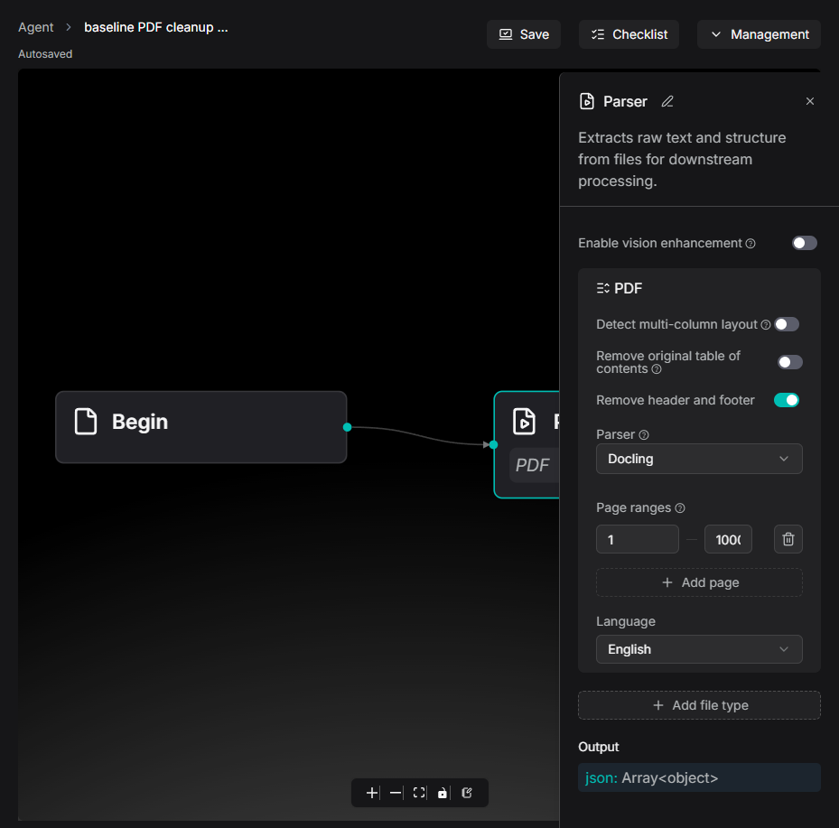
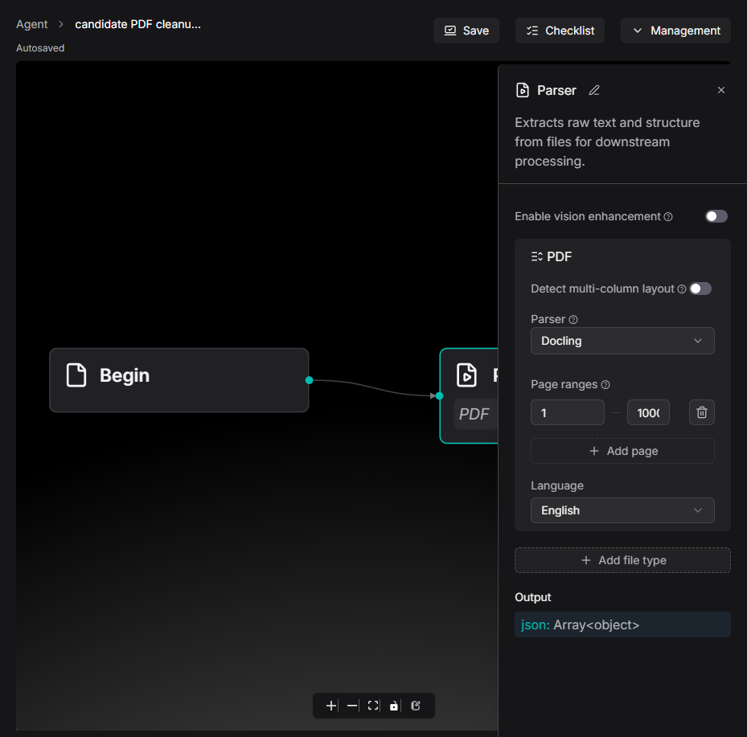

# RAGFlow PDF cleanup controls: reproduction and validation

Source: [`84ae4246afadcf18bb02d8521dee1bbe0c4ffa1e`](https://github.com/jipeng6036-del/ragflow/commit/84ae4246afadcf18bb02d8521dee1bbe0c4ffa1e); upstream baseline: [`7105b5dd34b2def8ad8662160533bd8faccce1f8`](https://github.com/infiniflow/ragflow/commit/7105b5dd34b2def8ad8662160533bd8faccce1f8). This is the interface alternative requested in [#21221](https://github.com/infiniflow/ragflow/issues/21221): hide cleanup switches where the current PDF path does not consume them. It does not implement remote PDF cleanup or outline generation.

The patch changes only `pdf-form-fields.tsx` and its new co-located regression file. DeepDoc/default and registered analyzer controls remain available; known unsupported methods and tenant OCR/vision selections hide them. Existing field values survive method switches. Model metadata uses the existing owner-scoped hook and query factory. No backend, shared UI primitive, schema, dependency or lockfile changed.

## Results

| Check | Baseline | Candidate |
| --- | --- | --- |
| New real form/selector cases | 18 fail, 6 pass | 24 pass |
| Related parser-form suites | - | 6 suites / 79 tests pass |
| Full lint and production Vite build | pass | pass |
| Changed-file format / actual Lefthook pre-commit and web-checks | - | pass; both web jobs actually inspected 2 files |
| Additional whole-web TypeScript | 146 diagnostics, exit 2 | identical 146 diagnostics, exit 2 |
| Additional whole-web Jest | 11 failed / 133 passed suites; 24 failed / 1035 passed tests | same 11 failed suites and 24 failed tests; 134 passed suites / 1059 passed tests |

**The additional whole-web checks remain red.** [The paired report](exact-lf-paired-results.json) compares every diagnostic and failing test/suite/load-failure ID under identical conditions: no new or removed failure, and no failure or diagnostic in the affected parser-form paths. The 24 new tests all pass. No tests were skipped or existing assertions weakened to obtain this result.

[Frontend guidance](https://github.com/infiniflow/ragflow/blob/7105b5dd34b2def8ad8662160533bd8faccce1f8/web/AGENTS.md#L24-L36) requires formatter/linter and a normal pre-commit hook. [Root guidance](https://github.com/infiniflow/ragflow/blob/7105b5dd34b2def8ad8662160533bd8faccce1f8/AGENTS.md#L145-L149) prefers affected-package checks; [CI](https://github.com/infiniflow/ragflow/blob/7105b5dd34b2def8ad8662160533bd8faccce1f8/.github/workflows/sep-tests.yml#L120-L145) runs changed-file pre-commit/web-checks. All applicable local gates above ran before the normal commit. Upstream CI can only be inspected after PR creation and may require a maintainer's `ci` label; no label/approval restriction was bypassed.

## Actual application proof and its limits

The actual production Vite application ran at `/agent/pdf-cleanup-proof?category=dataflow_canvas`, using its router, Parser node, PDF form, parser/model selector, Save handler, DSL serialization, and agent service. The local HTTP fixture supplies synthetic authentication, pipeline/model metadata, and JSON persistence. Save payloads were generated by the application, not constructed by a test helper.

The browser changed methods and values, clicked Save, captured native `PUT /api/v1/agents/pdf-cleanup-proof` and subsequent service `GET`, then reloaded and reopened the node. Docling, Naive (`Plain Text`) and tenant OCR hide the switches. Returning to DeepDOC restores the edited TOC=false/header-footer=true values, including after Save and reload. [Frozen request receipts](exact-lf-candidate-http-receipts-frozen.jsonl) and [browser results](exact-lf-candidate-browser-results.json) retain request/response bodies; [settled Docling proof](exact-lf-candidate-docling-visible-results.json) additionally checks the open panel and selector before capture.

This is **frontend and synthetic HTTP persistence proof**, not a running Go backend, database, PDF parser, external OCR/model or paid-service acceptance test. No external inference, mailbox or paid call was made. The fixture's authorization marker is intentionally `local-synthetic-fixture` and is not a credential.

| Before: Docling offers ineffective switches | After: Docling hides them |
| --- | --- |
|  |  |

[DeepDOC after reload](exact-lf-candidate-deepdoc-refresh.png), [tenant OCR after reload](exact-lf-candidate-tenant-refresh.png), [Naive after Save](exact-lf-candidate-naive-saved.png).

## Environment and commands

Linux x64 Debian 12, Node 22.23.4, npm 10.9.9, Lefthook 2.2.2; browser Chrome 151.0.7922.138 on Windows, Playwright CLI 0.1.22. [Runtime versions](exact-lf-runtime-versions.json) and [tree manifest](exact-lf-tree-manifest.json) record exact configurations. All 5,451 upstream tracked files and modes were checked against Git blobs: baseline had no mismatch; candidate differed only in the owning form plus the new 100644 test. The committed source blobs match the tested SHA-256 values in [the commit manifest](root-source-commit.json).

Install the locked dependencies with `npm ci` in both independent `web` trees. [exact-gates.cjs](exact-gates.cjs) records/runs the exact commands under `/work/baseline`, `/work/candidate` and `/evidence`: full `npm run lint`, `npm run type-check`, `npm run build`, `npm test -- --runInBand --json`, baseline plus the new regression, candidate parser-form tests and changed-file `oxfmt --check`. Full logs and exit codes are in [exact-lf-gates.json](exact-lf-gates.json). Large local Jest result JSONs are represented by their hashes in [raw-results-hashes.json](raw-results-hashes.json); full text logs are included.

The [hook runner](real-hooks.cjs) uses NUL-delimited file names as CI does, the actual project configuration and real Git history. Both web jobs ran on 2 files; [normal-commit-hook.log](normal-commit-hook.log) shows the subsequent normal `git commit` hook. No `--no-verify` was used.

For UI reproduction, run [exact-lf-page-server.cjs](exact-lf-page-server.cjs) with `baseline` or `candidate` after the corresponding production build. Replay [init-browser.js](init-browser.js), [baseline browser actions](exact-lf-baseline-browser.js), [candidate actions](exact-lf-candidate-browser.js), and the additional settled Docling actions with the existing Playwright CLI session. Ports were bound only to `127.0.0.1:19021`. The full scripts preserve the actual paths and commands used.

Only final exact-Git-blob evidence is published here. Earlier CRLF checkout, invalid/skip-only hook attempts and transitional screenshots were retained locally as setup corrections, not counted as passing checks.
