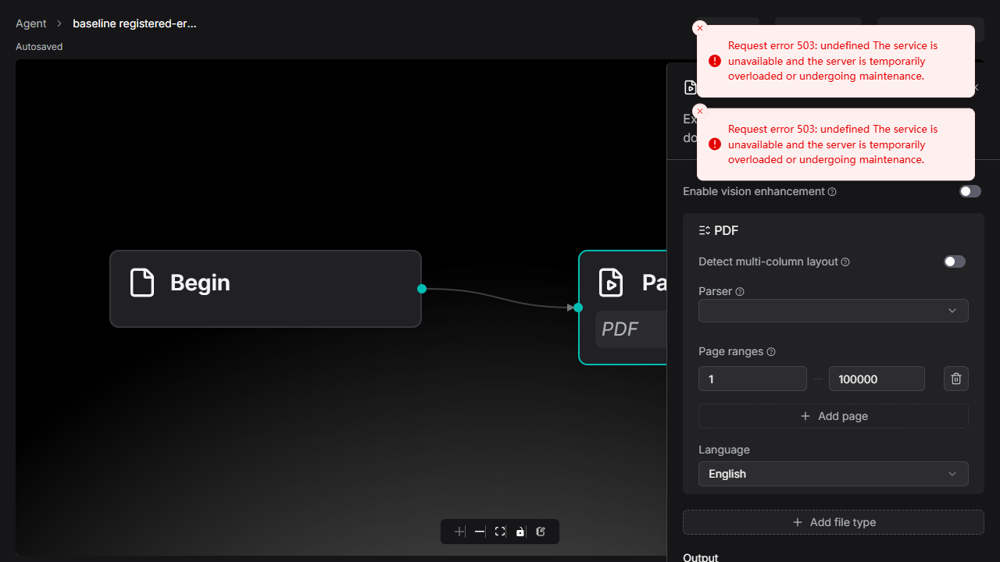
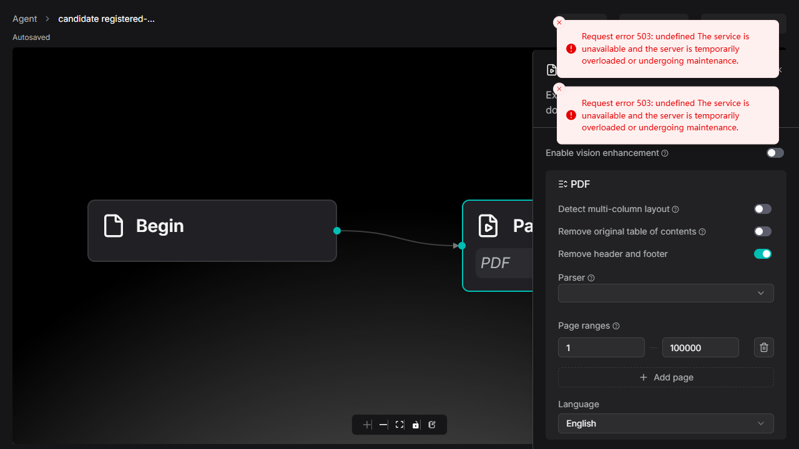

# RAGFlow #21440: registered analyzer controls during model lookup

Follow-up to [collaborator review #6395442046](https://github.com/infiniflow/ragflow/pull/21440#issuecomment-6395442046).

- Before: `84ae4246afadcf18bb02d8521dee1bbe0c4ffa1e` (the original PR commit).
- After: `aa4189ba737e38e0575e719de6aa41b3f896eb9c` on the same source branch, `fix/hide-unsupported-pdf-cleanup-options`.
- Only `web/src/pages/agent/form/parser-form/pdf-form-fields.tsx` and its colocated test changed: 73 insertions / 16 deletions. Dependencies, lockfile, configuration, backend and shared UI were unchanged.

The original fetch/error gate hid supported controls for registered analyzers while model metadata was unavailable. The fix preserves controls for an unclassified method, while continuing to hide known unsupported builtins, composite model selections and identified tenant models. Cached identified models remain hidden during a failed refetch. An opaque model ID can show controls until the query identifies it; the existing data cannot distinguish it from an analyzer before that point. Inactive opaque IDs remain the separately disclosed nonblocking limitation.

## Results

| Check | Before | After |
| --- | --- | --- |
| New 38-case regression against respective production code | 9 fail / 29 pass | 38 pass |
| Related parser-form suites |not repeated separately | 93 pass / 6 suites |
| Full lint and production build |pass |pass |
| Changed-file formatting and actual Lefthook pre-commit/web-checks |not an altered-source gate |pass, both web tools checked 2 files |
| Additional whole-web TypeScript | 146 diagnostics | same 146, no affected-path diagnostic |
| Additional full Jest | 1059 pass / 24 fail | 1073 pass / same 24 fail |

Full Jest retains the same 11 failed suites, including 3 suite-load failures. `paired-results.json` lists every compared diagnostic and failing assertion/suite; both parity and affected-path checks pass. This is not a claim that the entire repository is green. The pristine before run uses its original24-case test file; the separate38-case red overlay was restored before the full before run. No test skip or assertion reduction was added.

`final-quality-gates.json` records exact commands, exit codes and durations; `baseline-final-*.log` and `candidate-*.log` contain full raw text output. The two approximately 10 MB full Jest JSON reports are retained locally, indexed by SHA256 in `large-local-results-index.json`; they are not included in this public snapshot. Public full text logs and normalized failure IDs support the comparison. Focused regression JSON reports are included.

The real normal commit installed Lefthook 2.2.2 using its official installer and ran the pre-commit hook without bypass. See `normal-commit-hooks.json`. `real-hooks.json` separately records the actual pre-commit/web-checks with NUL-delimited input: oxfmt and oxlint each inspected the two files. Irrelevant Go/Python hook jobs were legitimately skipped.

## Actual built application proof

`baseline-browser-results.json` and `candidate-browser-results.json` both return `pass:true` across 20 recorded steps. Their assertions intentionally expect the old broken visibility before, and the corrected visibility after. `runtime-script-status.json` distinguishes wrapper exits from assertion results; a CLI exit alone is not treated as success.

The browser ran the real production application at `/agent/{id}?category=dataflow_canvas`, using its Parser form, selector, close-panel button, header Save, DSL serializer, native `PUT/GET /api/v1/agents/{id}`, and page reload. It did not set the application's form/store directly or construct Save requests by hand.

- A real pending metadata HTTP request stays unresolved while the form is used. Before: registered analyzer controls disappear. After: they stay editable and an edited `false/true` pair survives Save, native GET and reload.
- Metadata failure produces the actual owner-scoped503 response and the production query's two retries (three responses). The same edit/persistence/reload control succeeds after the fix.
- Docling still hides the switches while metadata is unavailable.
- An opaque tenant ID initially remains unclassified, then hides once successful metadata identifies it. Save/reload keeps it hidden. Switching back to DeepDOC restores the saved values, including after another Save/reload.

**Boundary:** `page-server.cjs` provides only local synthetic authentication, metadata and HTTP persistence. No Go backend, real external-analyzer registration/execution, PDF/OCR/model processing, or paid API was exercised. The unavailable-metadata selector can be blank; native request/readback proves the stored method without claiming a selector-label fix. Frozen HTTP receipts include earlier harness attempts; the final 20-step results identify the successful complete runs.

| Metadata503, saved and reloaded before | After |
| --- | --- |
|  |  |

Pending, opaque-model, Docling/error and DeepDOC-reload screenshots are also included, as unedited full-page captures.

## Versions and commands

Debian 12/Linux x64; Node 22.23.4, npm 10.9.9, Python 3.11.2; HeadlessChrome 151.0.7922.138 on Windows, Playwright CLI 0.1.22. Exact kernel/user agent are in `runtime-versions.json`. An isolated Docker container held real Git before/after trees and dependencies in an 8 GiB tmpfs; HTTP was bound only to 127.0.0.1:19022.

Install the checked-in `web/package-lock.json` dependencies with `npm ci`, then from `web/`:

```sh
npm test -- --runInBand src/pages/agent/form/parser-form/pdf-form-fields.test.tsx --coverage=false
npm test -- --runInBand src/pages/agent/form/parser-form --coverage=false
npm run lint
npm run build
./node_modules/.bin/oxfmt --check src/pages/agent/form/parser-form/pdf-form-fields.tsx src/pages/agent/form/parser-form/pdf-form-fields.test.tsx
npm run type-check
npm test -- --runInBand --json --outputFile=/evidence/candidate-jest-results.json
```

The recorded orchestration scripts give exact original arguments, paths and before-overlay restoration. Serve each built revision serially with `node /evidence/page-server.cjs baseline` or `candidate`, and run its actual browser script from this directory in the matching local Playwright session:

```powershell
npx.cmd --offline --yes --package @playwright/cli playwright-cli -s=ragflow21440review run-code --filename=baseline-browser.js
npx.cmd --offline --yes --package @playwright/cli playwright-cli -s=ragflow21440review run-code --filename=candidate-browser.js
```

`tree-manifest.json` compares all 5452 tracked blobs/modes: pristine before, exactly two altered contents after, both 100644. `source-hashes.json` and `root-committed-source.json` map the tested bytes to the actual commit. `runtime-build-manifest.json` hashes the complete served production bundles.

Initial Windows archive EOL drift was rejected before testing. A baseline mode drift after the red overlay was corrected to 644 and the complete final before checks were rerun. Candidate checks used 644 throughout. Early locator/dialog/outside-Save harness failures remain in their logs; the final harness waits for the actual dialog transition and closes the panel normally before Save. No product changes or weakened assertions accommodated the harness.

## DeepDoc-family scope

At the exact source revision, `RegisterAnalyzerFactory`/`validateParseMethod` support registered external analyzers; the registry starts empty. `internal/parser/parser/pdf_parser_common.go` mentions `deepdoc_ee` as an extension example, while `cmd/deepdoc_server_ee.go` reports that the EE server is not implemented. This does not establish a shipped OSS builtin or a running EE service. The UI preserves unclassified stored/custom methods without hardcoding that name, and the regression case checks only that UI behavior. There is no backend implementation change or EE runtime claim.

Hosted project CI is separate and requires the maintainer's `ci` label. No label/administrator restriction was bypassed.
